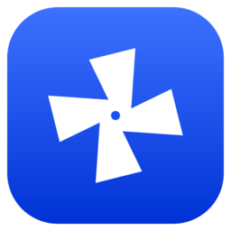
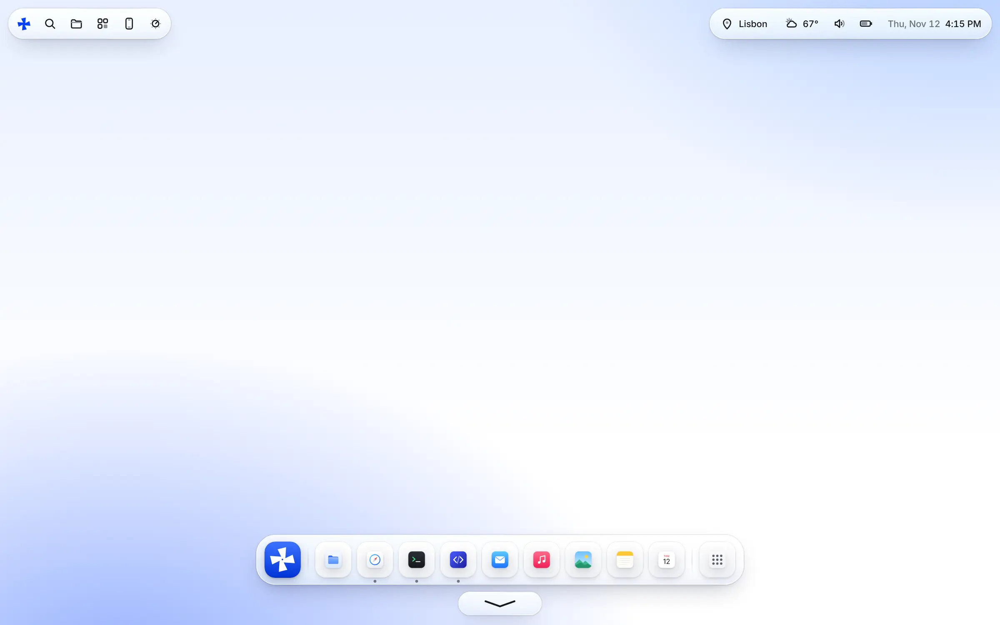
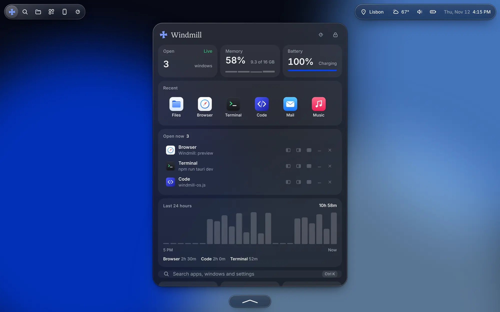
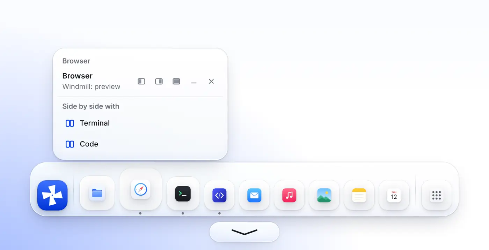
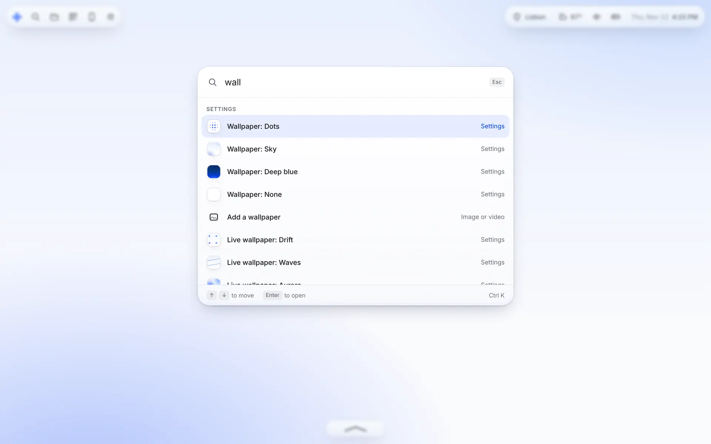
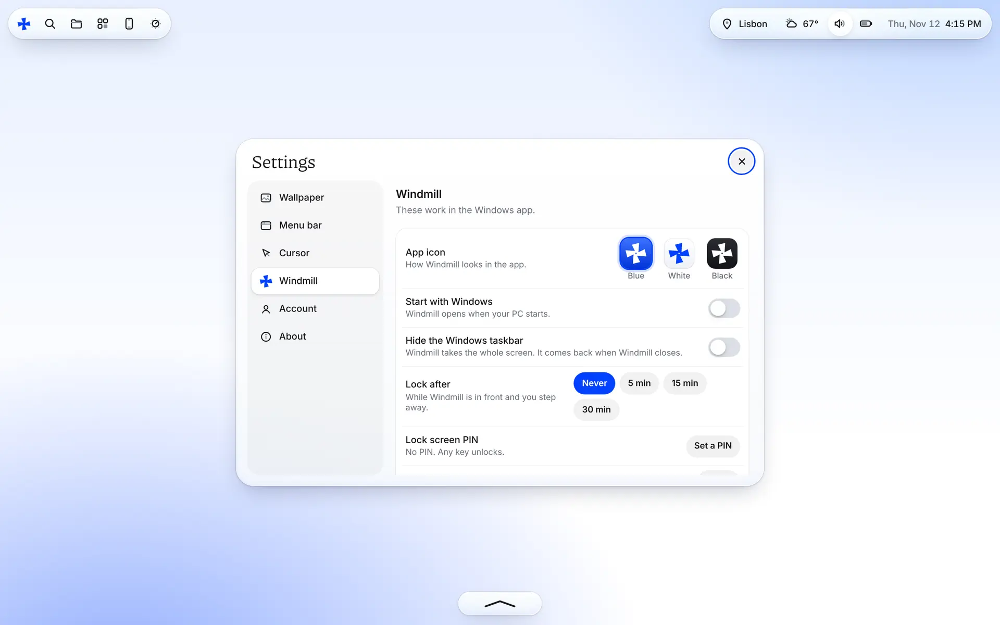

<p align="center">
  
</p>

<h1 align="center">Windmill</h1>

<p align="center">
  <b>Every app you own, in one calm space.</b><br>
  A calm, full-screen home for the apps on your Windows PC, with your Android phone as its remote.
</p>

<p align="center">
  <a href="https://github.com/ThatMaxwell/Windmill/releases/latest"><b>Download</b></a> ·
  <a href="https://thatmaxwell.github.io/Windmill/">Website</a> ·
  <a href="https://thatmaxwell.github.io/Windmill/app/">Try it in your browser</a>
</p>



> **Early preview.** Windmill 0.1 works, but expect rough edges. Bug reports are welcome in [Issues](https://github.com/ThatMaxwell/Windmill/issues).

## What it is

Windmill is **not** a new operating system. It's an app that runs full screen on Windows and gives the apps you already have a quieter home: a real dock, one panel for everything else, and wallpapers that move slowly behind it all. Windows is still underneath, and you can leave Windmill whenever you like.

## Features

- **Your real apps.** Everything installed on your PC, Store apps included, shows up with its real icon. Keep favorites in the dock, open everything else from **All apps**, and see which apps are running.
- **The Windmill panel: Ctrl + Win.** One shortcut, from anywhere: what's open, recent apps, memory, processor and battery, your last 24 hours of screen time, and **Lock**, **Restart** or **Shut down** Windmill.
- **Multitasking.** Hover an open app in the dock to snap it to the left or right half, fill the screen, minimize, close, or put it side by side with another window.
- **Windmill Search: Ctrl + K.** Open apps, jump to windows, change the wallpaper or lock, all from the keyboard.
- **Control center.** Your PC's real volume and brightness, Wi-Fi, Bluetooth, Do Not Disturb and dark mode.
- **A lock screen of its own**, with an optional four-digit PIN and auto-lock when you step away.
- **Wallpapers.** Dots, Sky, Deep blue, three live wallpapers (Drift, Waves, Aurora), or any photo or video of your own.
- **Make it yours.** Light or dark, the app icon in blue, white or black (Windows and your phone's home screen follow), which buttons show in the top bar, your cursor, adaptive icons.
- **Your PC from your phone.** Pair the Android app with a six-digit code and use your PC's screen live with touch and your phone's keyboard.
- **Set up in a minute.** Country, language, time format, light or dark, wallpaper, picked on a 3D wheel.
- **Sign in with GitHub**, using a one-time code (no password in the app).

| | |
|---|---|
|  |  |
|  |  |

<sub>Screenshots use example data.</sub>

### Shortcuts

| Shortcut | What it does |
|---|---|
| **Ctrl + Win** | Open or close the Windmill panel |
| **Ctrl + K** | Windmill Search |
| **Ctrl + Shift + A** | All apps |
| **Ctrl + Shift + C** | Control center |
| **Ctrl + Shift + L** | Lock Windmill |
| **Ctrl + /** | Show all shortcuts |
| **Esc** | Close whatever is open |

## Download

Get both from the [latest release](https://github.com/ThatMaxwell/Windmill/releases/latest).

**Windows 10 or 11 (64-bit):** download `Windmill-Windows-Setup.exe` and run it. It installs just for you, with no admin rights needed. The installer isn't signed yet, so Windows SmartScreen may warn you: choose **More info → Run anyway**. Windmill starts with Windows from then on; you can switch that off in Settings.

**Android 7 or newer:** download `Windmill-Android.apk` on your phone and open it. Android will ask you to allow installing apps from your browser the first time.

**To leave Windmill:** press **Ctrl + Win** and choose **Shut down**. Windmill asks your open apps to close (so they can save), quits, and brings the Windows taskbar back.

## Use your PC from your phone

1. On your PC, open Windmill → **Phone** → turn on **Let my phone connect**. It shows your PC's address and a six-digit code.
2. Open Windmill on your phone and type the address and code.
3. Your screen appears. Tap to click, hold to right-click, drag to move things, scroll with two fingers, and use the keyboard button to type. The Windmill button opens the panel on your PC.

How it stays safe:

- It's **off until you turn it on**, and you can turn it off any time.
- It only listens on your **local network** (port `47321`). The first time, Windows asks whether Windmill can use private networks: choose **Allow**.
- A phone must send the **six-digit code** before anything else. You can make a new code whenever you like.
- Only **one phone** can be connected at a time.
- The connection isn't encrypted yet, so only use it on networks you trust, like your home Wi-Fi.

## Privacy

- **Screen time** is counted on your PC and saved only in Windmill's data folder. It's never sent anywhere.
- **The phone remote** connects directly over your own network. There's no Windmill server in between.
- **Weather** comes from [Open-Meteo](https://open-meteo.com/). Windmill sends it the city name taken from your time zone, nothing else.
- **Sign in with GitHub** keeps your token on your PC, in Windmill's data folder. Sign out in Settings → Account to remove it.

## Build it yourself

You need [Node.js 22](https://nodejs.org/) and [Rust](https://rustup.rs/) (stable).

### Windows app

Also needs the Visual Studio C++ Build Tools and WebView2 (already part of Windows 11).

```bash
cd desktop
```

```bash
npm install
```

```bash
npx tauri dev
```

`npx tauri build` makes the installers in `desktop/src-tauri/target/release/bundle/`.

### Android app

Also needs the Android SDK and NDK and Java 17 (`ANDROID_HOME` and `NDK_HOME` set).

```bash
cd desktop
```

```bash
npx tauri android init
```

```bash
python3 android/patch.py
```

```bash
npx tauri android build --apk
```

`android/patch.py` adds the three switchable launcher icons and the small native plugin that switches between them.

### Sign in with GitHub

Create a [GitHub OAuth App](https://github.com/settings/developers) with **Enable Device Flow** ticked, then build with its Client ID in `WINDMILL_GITHUB_CLIENT_ID` (or set it as a repository variable of the same name and the release workflow uses it). Without it, the sign-in button simply says **Continue**.

### The interface without building anything

The whole interface runs in a browser with example data:

```bash
npx serve docs
```

Then open `/app/`. Inside the app, the same page talks to your real PC instead.

## How it's built

Windmill is a [Tauri 2](https://tauri.app/) app: a Rust backend talks to Windows, and the interface is one web page.

```
docs/
  index.html          The website
  app/
    index.html        The Windmill interface: intro, sign-in, setup, home, dock, windows, settings
    windmill-os.js    The layer that connects the interface to the real PC (or example data on the web)
    windmill-os.css
  assets/             Screenshots and icons
desktop/
  src-tauri/
    src/lib.rs        App setup and the list of commands the interface can call
    src/shell.rs      Those commands
    src/win/          Windows: apps.rs, windows.rs (snap, focus), audio.rs, system.rs (battery,
                      memory, brightness, Wi-Fi, power, taskbar), hotkey.rs (Ctrl + Win),
                      usage.rs (screen time), remote.rs (the phone connection), icons.rs
    src/github.rs     Sign in with GitHub (device flow)
    src/appicon.rs    Switching the app icon
  android/            The launcher icon plugin and the patch that wires it in
.github/workflows/build.yml   Builds the Windows installer and the Android app
```

## Releases

Every push to `main` builds the Windows installer and the Android app as downloadable workflow artifacts. To publish a release, open **Actions → Build Windmill → Run workflow** and enter a version tag such as `v0.2.0`. The workflow builds everything, creates the tag and publishes the release.

## What's next

- Settings sync across PCs, through a private GitHub Gist
- Turning Wi-Fi and Bluetooth on and off right from the control center
- Choosing which screen the phone shows on multi-monitor PCs, and an encrypted phone connection
- A signed Windows installer and one signing key for every Android release
- Windmill on the phone itself, not just as a remote

## License

A license hasn't been chosen yet.
